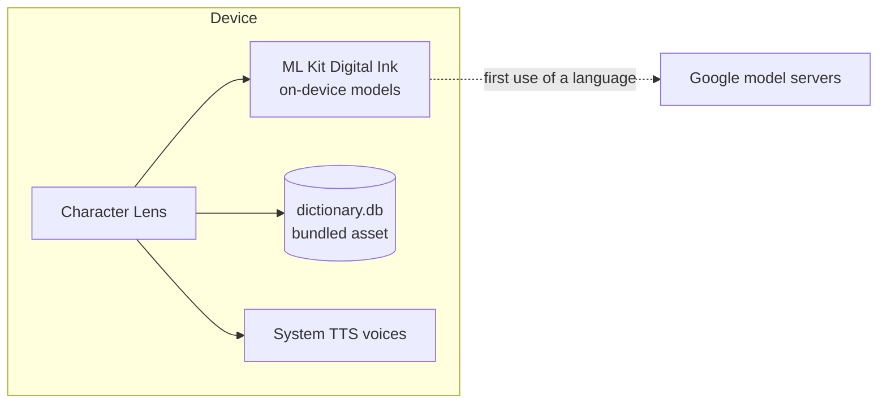
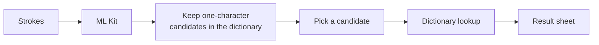
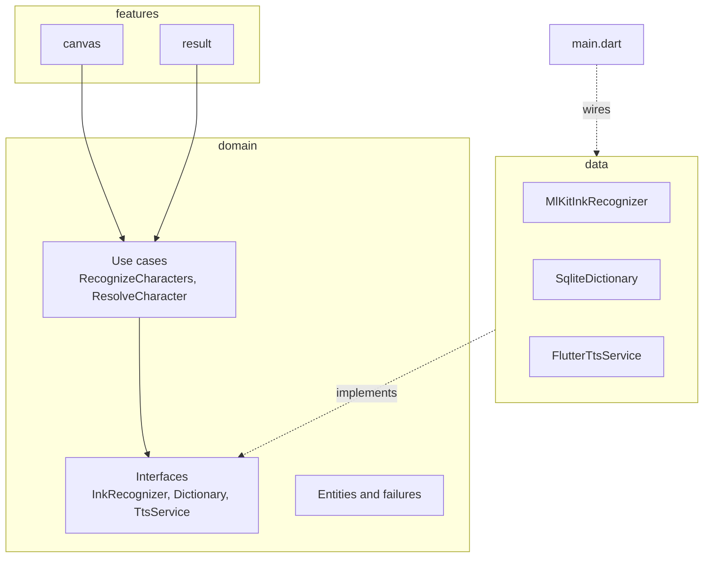

# Character Lens

Draw a Chinese or Japanese character with your finger and look it up. The app recognizes the strokes on the device, then shows the reading, the meaning, and how the same character is written and read in Chinese, Japanese and Korean (Hanja).

It is a portfolio project and still in progress. The product spec is in [docs/prd.md](docs/prd.md) and the decisions so far are in [docs/adr](docs/adr).

## Features

Built:

- [x] Drawing canvas with undo, clear, and recognition after a short pause or on demand
- [x] On-device recognition with Google ML Kit Digital Ink (Chinese and Japanese), with a model download state
- [x] Candidates filtered to characters that exist in the dictionary, at most five
- [x] Offline dictionary: a bundled SQLite file built from Unihan by a script in this repo
- [x] Result sheet: reading and meaning from the dictionary, the same character across Chinese, Japanese and Korean, and "Not it?" to switch candidate
- [x] Pronunciation with the voices installed on the device, with a message when there is none
- [x] Clean Architecture in three layers (`features`, `domain`, `data`), with no Flutter imports in `domain`
- [x] Riverpod with sealed states, and typed failures that each end in a readable message
- [x] Unit and widget tests, run with `flutter analyze` and `flutter test` in GitHub Actions

Planned:

- [ ] AI explanation (components, mnemonic, example words) from Gemini, clearly labeled and checked against the dictionary
- [ ] Cache and history
- [ ] Evaluation script with real results
- [ ] Demo video and case study

## Tech stack

| Area | Tools |
| --- | --- |
| Framework | Flutter, Dart |
| State | `flutter_riverpod`, `equatable` |
| Handwriting recognition | `google_mlkit_digital_ink_recognition` |
| Dictionary | `sqflite`, built from Unihan with `sqlite3` |
| Speech | `flutter_tts` |
| Tests | `flutter_test`, `mocktail`, `fake_async`, `sqflite_common_ffi` |
| CI | GitHub Actions |

## System design

There is no backend. Everything runs on the device, except the one-time download of each recognition model.



From stroke to result:



Strokes stay on the device. Readings and meanings come only from the dictionary.

## Architecture



- **Features** hold screens, widgets and Riverpod controllers. They know the domain interfaces, never the concrete classes.
- **Domain** is plain Dart with no Flutter imports. A use case exists only where there is a rule to apply: `RecognizeCharacters` filters candidates, and `ResolveCharacter` decides which readings to show for each language.
- **Data** implements the interfaces. `main.dart` is the only place that names the concrete classes and overrides the providers, and tests override them with fakes.
- **State** is a sealed class per concern: `CanvasState`, `LookupState` and `SpeechState`. The result sheet has its own state so closing it leaves the strokes and candidates as they were. See [ADR 004](docs/adr/004-riverpod-sealed-states.md).
- **Failures** are typed (`InkFailure`, `DictionaryFailure`), and each one ends in a message the user can read.

Decision records: [ADR 001](docs/adr/001-ml-kit-digital-ink.md) for recognition and [ADR 004](docs/adr/004-riverpod-sealed-states.md) for state. The dictionary decision and a data-flow page are coming with the end of this milestone.

## Project structure

```
lib/
  features/   canvas, result       screens, widgets, Riverpod controllers
  domain/     entities, failures, repository interfaces, use cases
  data/       ink, dictionary, tts  implementations of the interfaces
  core/       theme
tool/         builds the dictionary from Unihan
assets/db/    the bundled dictionary and its license
docs/         spec, design prototype, decision records
```

Features depend on the domain, and `data` implements the domain interfaces. `main.dart` is the only place that names the concrete classes.

## Run it

```
flutter pub get
flutter run
```

The first time you draw in a language, the app downloads that language's recognition model from Google, so that step needs a connection that can reach Google's servers. After that, recognition and the dictionary work offline.

```
flutter analyze
flutter test
```

iOS has not been built or run. The Android checks so far were on an emulator.

## Tests

339 tests: domain rules, the dictionary builder, SQLite access, the ML Kit adapter with fakes, controllers with `fake_async`, and widget tests that drive the real screen, including 1.5x text scale on a narrow screen.

Line coverage of the files the tests load, measured with `flutter test --coverage` on 2026-10-28:

| Area | Lines covered |
| --- | --- |
| `lib/domain` | 92% |
| `lib/data` | 85% |
| `lib/features/canvas` | 99% |
| `lib/features/result` | 99% |
| All | 96.5% (1143 of 1185) |

Two gaps behind that number. The adapters that call the real ML Kit plugin (`lib/data/ink/ink_plugin.dart`) are not run by any test, because the plugin needs a device. `lib/main.dart` is not counted, because no test loads it. Coverage says which lines ran, not that the behavior is right. Some tests were also checked by breaking the code on purpose and confirming they fail.

```
flutter test --coverage
```

## Data and attribution

Readings, meanings and variant forms come only from a SQLite dictionary bundled in the app (`assets/db/dictionary.db`, 60,183 characters). It is built from the Unicode Han Database (Unihan) 18.0.0, dated 2026-07-31:

- Mandarin, Japanese on and kun, and Korean (Hangul) readings
- English definitions
- simplified and traditional variants

The Unihan files are not in the repo. To rebuild the dictionary, download and unzip `Unihan.zip` from unicode.org, then run:

```
dart run tool/build_dictionary.dart <unihan folder> [output path]
```

Unihan data is Copyright (c) 1991-2026 Unicode, Inc. and is used under the Unicode License v3. The license text is in [assets/db/UNICODE-LICENSE.txt](assets/db/UNICODE-LICENSE.txt). The dictionary keeps selected fields and reorganizes them, so it is not the official Unicode data, and Unicode does not endorse this app.

## Known limits

- Pronunciation comes from the device's voice engine. It reads the character in its own way, which can differ from the reading in the dictionary card. Korean engines often cannot read Hanja.
- Unihan does not link every pair of simplified, traditional and Japanese forms. For some characters a reading is borrowed from one linked variant, and the card says so. Other pairs stay unlinked.
- Recognition quality comes from ML Kit. The decision record has the measurements taken so far, and they are small.

## Fonts

Instrument Sans and Newsreader are bundled under the SIL Open Font License 1.1. The license texts are in `assets/fonts`.

## License

The code is MIT, see [LICENSE](LICENSE). The bundled data and fonts keep their own licenses, listed above.

## Author

Nicodemus Lin, Senior Flutter Engineer. [nicolin.dev](https://www.nicolin.dev/) · [LinkedIn](https://www.linkedin.com/in/nicodemus-lin/)
