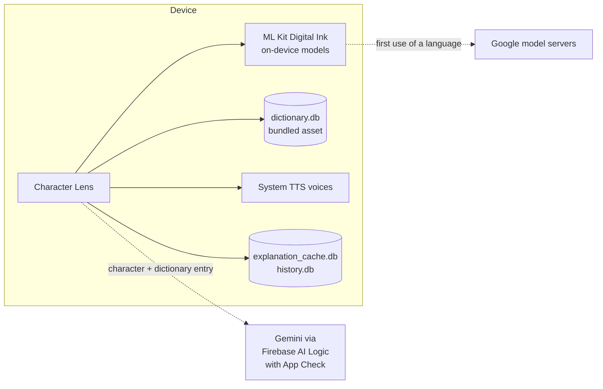
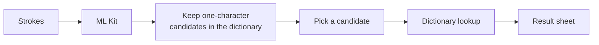
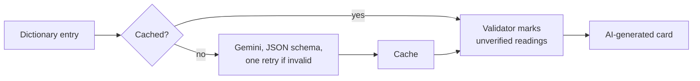
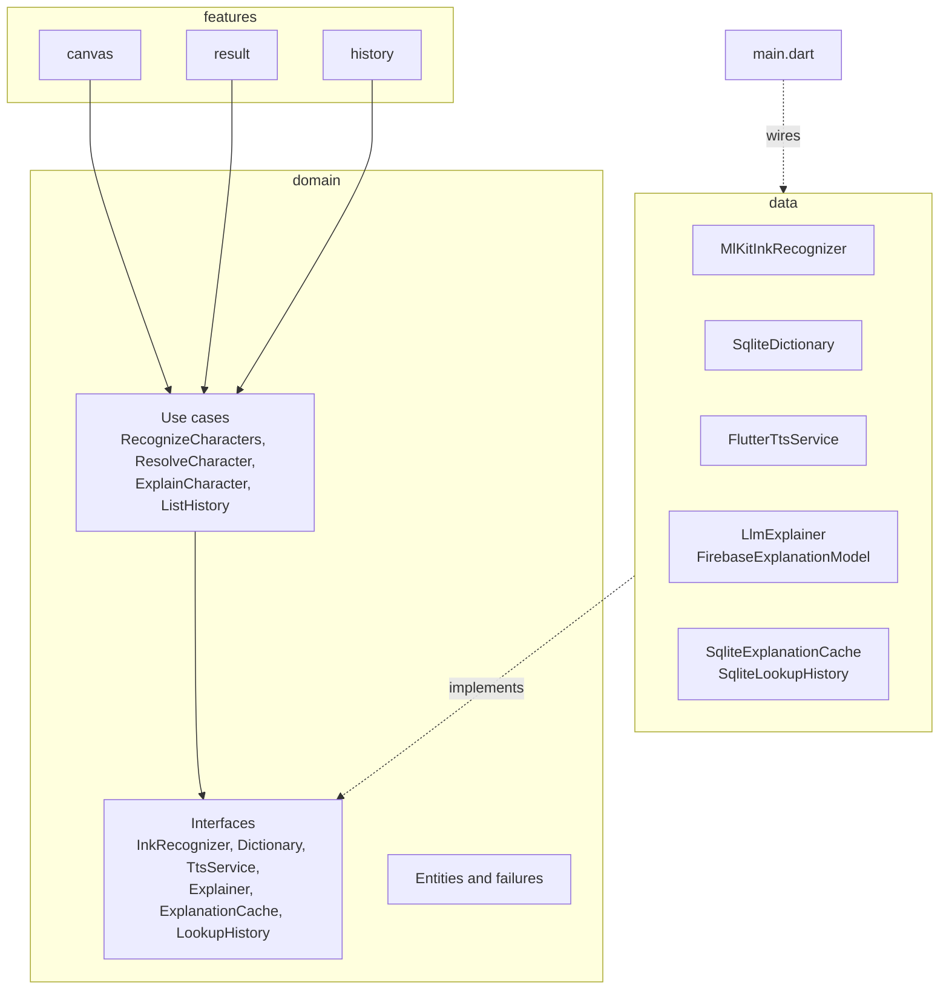
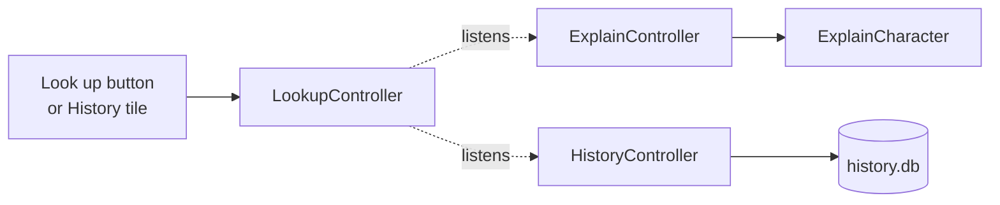

# Character Lens

Draw a Chinese or Japanese character with your finger and look it up. The app recognizes the strokes on the device, then shows the reading, the meaning, and how the same character is written and read in Chinese, Japanese and Korean (Hanja).

It is a portfolio project and still in progress. The product spec is in [docs/prd.md](docs/prd.md) and the decisions so far are in [docs/adr](docs/adr).

## Features

Built:

- [x] Drawing canvas with undo, clear, and recognition after a short pause or on demand
- [x] On-device recognition with Google ML Kit Digital Ink (Chinese and Japanese), with a model download state
- [x] Candidates filtered to characters that exist in the dictionary, at most five
- [x] Offline dictionary: a bundled SQLite file built from Unihan by a script in this repo
- [x] Result sheet: reading and meaning from the dictionary, the same character across Chinese, Japanese and Korean, and "Not it?" to switch candidate
- [x] Pronunciation with the voices installed on the device, with a message when there is none
- [x] Clean Architecture in three layers (`features`, `domain`, `data`), with no Flutter imports in `domain`
- [x] Riverpod with sealed states, and typed failures that each end in a readable message
- [x] AI explanation (components, memory hook, example words) from Gemini through Firebase AI Logic, in its own card labeled "AI-generated". The dictionary card never waits for it
- [x] A validator that marks an example reading the dictionary does not confirm as unverified
- [x] Explanations cached per character, language and prompt version, so each character costs one model call
- [x] History of the last 50 characters, reopened from the cache without a network
- [x] Unit and widget tests, run with `flutter analyze` and `flutter test` in GitHub Actions

Planned:

- [ ] Demo video and case study

## Tech stack

| Area | Tools |
| --- | --- |
| Framework | Flutter, Dart |
| State | `flutter_riverpod`, `equatable` |
| Handwriting recognition | `google_mlkit_digital_ink_recognition` |
| Dictionary | `sqflite`, built from Unihan with `sqlite3` |
| Speech | `flutter_tts` |
| AI explanation | `firebase_ai` (Gemini), `firebase_core`, `firebase_app_check` |
| Tests | `flutter_test`, `mocktail`, `fake_async`, `sqflite_common_ffi` |
| CI | GitHub Actions |

## System design

There is no backend of my own. Recognition, the dictionary, the cache and the history run on the device. The network is used for the one-time download of each recognition model, and for the AI explanation, which is optional.



From stroke to result:



Then the AI card, after the dictionary card is already on screen:



Strokes stay on the device. Readings and meanings come only from the dictionary. The model gets the recognized character and its dictionary entry, its answer is labeled AI-generated, and the readings in its example words are checked against the dictionary.

## Architecture



- **Features** hold screens, widgets and Riverpod controllers. They know the domain interfaces, never the concrete classes.
- **Domain** is plain Dart with no Flutter imports. A use case exists only where there is a rule to apply: `RecognizeCharacters` filters candidates, `ResolveCharacter` decides which readings to show for each language, `ExplainCharacter` reads the cache before the model and runs the validator, and `ListHistory` joins saved lookups with the dictionary.
- **Data** implements the interfaces. `main.dart` is the only place that names the concrete classes and overrides the providers, and tests override them with fakes.
- **State** is a sealed class per concern: `CanvasState`, `LookupState`, `SpeechState`, `ExplainState` and `HistoryState`. The result sheet has its own state so closing it leaves the strokes and candidates as they were. See [ADR 004](docs/adr/004-riverpod-sealed-states.md).
- **Failures** are typed (`InkFailure`, `DictionaryFailure`, `ExplanationFailure`), and each one ends in a message the user can read.

Who listens to whom: one state, the lookup of a character, is the hub. The AI card and the history listen to it and never change it.



More in [docs/architecture.md](docs/architecture.md).

Decision records: [ADR 001](docs/adr/001-ml-kit-digital-ink.md) for recognition, [ADR 002](docs/adr/002-unihan-dictionary.md) for the dictionary, [ADR 003](docs/adr/003-firebase-ai-logic.md) for Gemini through Firebase AI Logic, [ADR 004](docs/adr/004-riverpod-sealed-states.md) for state and [ADR 005](docs/adr/005-grounded-llm.md) for the grounding and the validator. [docs/data-flow.md](docs/data-flow.md) follows a drawing from strokes to result and lists every failure path with its test, and [docs/ai-usage.md](docs/ai-usage.md) covers the AI parts, their cost and their limits.

## Project structure

```
lib/
  features/   canvas, result, history, home  screens, widgets, Riverpod controllers
  domain/     ink, dictionary, explainer, tts  entities, failures, interfaces, use cases
  data/       ink, dictionary, ai, cache, tts  implementations of the interfaces
  core/       theme
tool/         builds the dictionary from Unihan
assets/db/    the bundled dictionary and its license
docs/         spec, design prototype, decision records
```

Features depend on the domain, and `data` implements the domain interfaces. `main.dart` is the only place that names the concrete classes.

## Run it

```
flutter pub get
flutter run
```

The first time you draw in a language, the app downloads that language's recognition model from Google, so that step needs a connection that can reach Google's servers. After that, recognition and the dictionary work offline.

```
flutter analyze
flutter test
```

iOS has not been built or run. The Android checks so far were on an emulator.

The AI explanation needs Firebase settings. They are optional and kept out of the repo: see [docs/firebase-setup.md](docs/firebase-setup.md). Without them the app runs as before, and the AI card says it is not set up in this build.

## Tests

624 tests: domain rules, the dictionary builder, SQLite access, the ML Kit adapter and the Gemini caller with fakes, controllers with `fake_async`, and widget tests that drive the real screen, including 1.5x text scale on a narrow screen.

Line coverage of the files the tests load, measured with `flutter test --coverage` on 2026-10-31:

| Area | Lines covered |
| --- | --- |
| `lib/domain` | 92% |
| `lib/data` | 90% |
| `lib/features/canvas` | 99% |
| `lib/features/result` | 98% |
| `lib/features/history` | 97% |
| All | 95.9% (1831 of 1909) |

Two gaps behind that number. The adapters that call the real ML Kit plugin (`lib/data/ink/ink_plugin.dart`) are not run by any test, because the plugin needs a device. `lib/main.dart`, `firebase_bootstrap.dart`, `firebase_config.dart` and `firebase_explanation_model.dart` are not counted, because no test loads them: they start Firebase or call Gemini, which needs a real project. The prompt, the retry, the parser and the failure mapping around that call are tested with a fake model. Coverage says which lines ran, not that the behavior is right. Some tests were also checked by breaking the code on purpose and confirming they fail.

```
flutter test --coverage
```

## Data and attribution

Readings, meanings and variant forms come only from a SQLite dictionary bundled in the app (`assets/db/dictionary.db`, 60,183 characters). It is built from the Unicode Han Database (Unihan) 18.0.0, dated 2026-07-31:

- Mandarin, Japanese on and kun, and Korean (Hangul) readings
- English definitions
- simplified and traditional variants

The Unihan files are not in the repo. To rebuild the dictionary, download and unzip `Unihan.zip` from unicode.org, then run:

```
dart run tool/build_dictionary.dart <unihan folder> [output path]
```

Unihan data is Copyright (c) 1991-2026 Unicode, Inc. and is used under the Unicode License v3. The license text is in [assets/db/UNICODE-LICENSE.txt](assets/db/UNICODE-LICENSE.txt). The dictionary keeps selected fields and reorganizes them, so it is not the official Unicode data, and Unicode does not endorse this app.

## Privacy

Strokes never leave the device. The AI request holds only the recognized character, the language and its dictionary entry. There is no account and no analytics. If you run it with your own Firebase project on the Gemini free tier, the pricing page (checked 2026-10-27) says the content sent is used to improve Google products.

## Known limits

- The AI explanation is labeled and its example readings are checked, but the check is loose. "Verified" means the dictionary does not disagree, not that the word's reading is right, and correct readings with sound changes (学校 is がっこう) get flagged. Components, memory hooks and usage notes are not checked at all, and a memory hook can be plausible-sounding folk etymology. See [ADR 005](docs/adr/005-grounded-llm.md).
- AI latency varies a lot. On an emulator the spike had medians of 3.2 to 3.9 s (20 calls), and a second run had a median of 6.2 s with one call at 24 s, past the 15 s timeout (11 calls, a poor network at the time). The "under 4 s" target is not shown to be met, and it was not measured on a physical device. App Check with Play Integrity is not confirmed to be enforced yet.
- No formal evaluation of the AI explanations was run. The checks that were done are small, and they are listed in [docs/ai-usage.md](docs/ai-usage.md).
- Pronunciation comes from the device's voice engine. It reads the character in its own way, which can differ from the reading in the dictionary card. Korean engines often cannot read Hanja.
- Unihan does not link every pair of simplified, traditional and Japanese forms. For some characters a reading is borrowed from one linked variant, and the card says so. Other pairs stay unlinked.
- Recognition quality comes from ML Kit. The decision record has the measurements taken so far, and they are small.

## Fonts

Instrument Sans and Newsreader are bundled under the SIL Open Font License 1.1. The license texts are in `assets/fonts`.

## How it was built

I wrote the specification, the architecture and the decision records, and reviewed every change. I used Claude Code for implementation and test writing, working in small steps under the rules in [CLAUDE.md](CLAUDE.md). Each step ends with `flutter analyze` and `flutter test`, and tests are checked by breaking the code on purpose and confirming they fail.

## License

The code is MIT, see [LICENSE](LICENSE). The bundled data and fonts keep their own licenses, listed above.

## Author

Nicodemus Lin, Senior Flutter Engineer. [nicolin.dev](https://www.nicolin.dev/) · [LinkedIn](https://www.linkedin.com/in/nicodemus-lin/)
