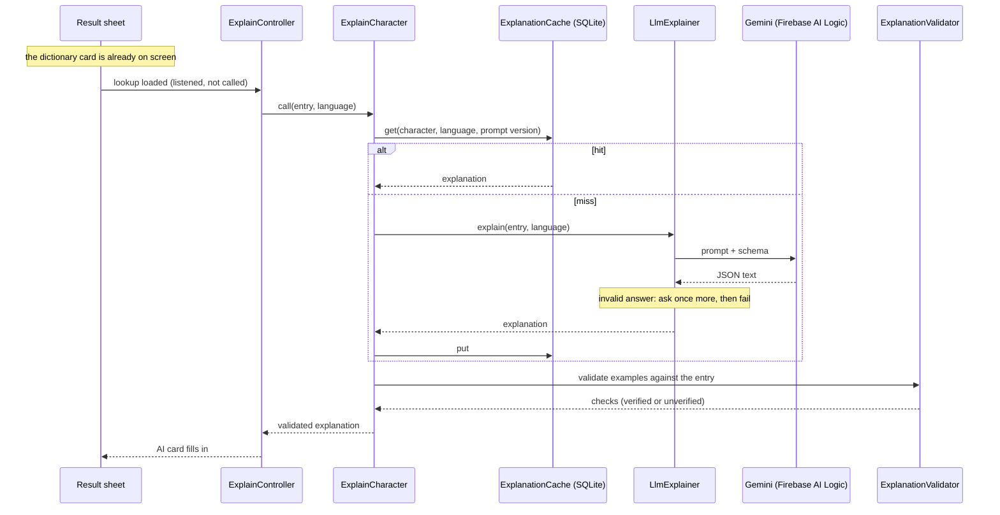

# AI usage

Where AI is used in Character Lens, why each piece runs where it does, what the app trusts it for, and what is not known. Numbers are from the runs described in [ADR 003](adr/003-firebase-ai-logic.md) and [ADR 001](adr/001-ml-kit-digital-ink.md). Anything not measured is said so.

## Two uses of AI, run in two places

| | Handwriting recognition | Explanation |
| --- | --- | --- |
| Model | Google ML Kit Digital Ink | Gemini (`gemini-3.1-flash-lite`) through Firebase AI Logic |
| Runs | On the device | In the cloud |
| What it receives | The strokes | The recognized character and its dictionary entry |
| Needs network | Once per language, to download the model | Every time, unless the answer is cached |
| Decides | Which characters to offer | Nothing. It writes an explanation |
| Why there | Strokes are personal and recognition has to feel immediate. It also has to work offline | A general language model is needed, and there is no on-device one in this project |

**Strokes never leave the device.** The request builder (`ExplanationPromptBuilder`) takes a dictionary entry and a language and nothing else, and a test checks what it puts in the request. Recognition happens before any network call.

## What the app trusts the model for

Nothing factual. The rules, in order of strength:

1. Readings and definitions on the dictionary card come only from the bundled Unihan dictionary ([ADR 002](adr/002-unihan-dictionary.md)).
2. The dictionary card is drawn first and never waits for the model.
3. The explanation is a separate card with an "AI-generated" badge and a note that memory hooks can be plausible-sounding folk etymology.
4. Readings inside the explanation (the example words) are checked against the dictionary and marked "Unverified reading" when the dictionary does not confirm them. See [ADR 005](adr/005-grounded-llm.md) for the rules and their limits.

The model is asked for a mnemonic, the components of the character, two example words and, when Chinese and Japanese use it differently, one usage note. None of these except the example readings can be checked by the app.

## Flow

The controller only reads the lookup state. It starts when the lookup is loaded and goes back to idle when the sheet closes, has nothing to explain, or the user switches character. A request counter drops an answer that arrives after the user moved on.

## Prompt and schema versions

- The prompt text and the schema are in the repo: `lib/data/ai/prompt_v1.dart` and `lib/data/ai/explanation_schema.dart`.
- `promptVersion` (`prompt_v1`) is part of the cache key. Change it with any change to the prompt, the schema, or the model, and the next view of each character asks again.
- The parser and the schema are tied by a test, so a field cannot be added to one and forgotten in the other.
- No prompt version was compared with another, because only `prompt_v1` exists.

## Cost and latency

| | Value | Source |
| --- | --- | --- |
| Time per call, debug build | median 3.9 s, 3.1 to 5.3 s, n=10 | spike, emulator |
| Time per call, release build | median 3.2 s, 3.0 to 8.7 s, n=10 | spike, emulator |
| Time per call, second run, debug build | median 6.2 s, 3.2 to 24.2 s, n=11 | 2026-10-31, emulator, a poor network at the time |
| First two calls ever | 8.2 s and 5.6 s | spike, includes the App Check token exchange |
| Tokens per call | 386 to 528 in total | `usageMetadata` in the spike and the second run (387 to 515) |
| Price per call, paid list | about $0.0002 to $0.0004 | derived from the price page of 2026-10-27, not billed |
| Price on the free tier | $0 | pricing page |
| Cache hit | no call, shown at once | tested; seen on the emulator after the first answer |

What the numbers do not cover: a physical device, a slow network, many users, the free-tier rate limits, or latency across a longer period. The PRD target is "under 4 s typical, with a skeleton". The spike medians were under it, the second run's median was not (6.2 s), and one of its 11 calls went past the 15 s timeout and showed the timeout card. Latency varies a lot, so the target is not shown to be met.

## Failure paths

Every failure leaves the dictionary card in place and shows one quiet line in the AI card. Nothing here is cached, so opening the character again tries again.

| What happens | What the card says | Test |
| --- | --- | --- |
| No Firebase settings in the build | "AI explanation is not set up in this build." | `explain_controller_test`: not configured is Unavailable |
| No connection | "No connection, so there is no AI explanation. Open it again to retry." | `firebase_failure_mapper_test`: a socket error is offline. Seen on the emulator in airplane mode |
| Timeout (15 s per attempt) | "The AI explanation took too long. Open it again to retry." | `llm_explainer_test`: ends a call that never answers, with no retry |
| Invalid JSON, twice | "The AI explanation could not be used." | `llm_explainer_test`: twice is dropped, after exactly one retry |
| App Check, bad key, quota, blocked answer | "The AI service refused the request." | `firebase_failure_mapper_test`: App Check failing, a rejected API key, a quota that is used up, an answer that was blocked |
| Anything else | "AI explanation is unavailable right now. Open it again to retry." | `firebase_failure_mapper_test`: a server error is a general failure |
| User moves on while it loads | Dropped, nothing shown | `explain_controller_test`: an answer that arrives after the sheet closed is dropped |
| Cache cannot be read or written | Treated as a miss, or the answer is kept for this view | `explain_character_test`: a cache that cannot be read is a miss; a cache that cannot be written does not lose the answer |

Seen on the emulator: the offline card, the timeout card (once, for 水 in Japanese), the refused card (with a deliberately wrong API key, so the underlying error is not known), the 1.5x system font on the AI card, and Japanese. Not tried: an App Check rejection with enforcement on, and a physical device.

## Privacy

- Strokes stay on the device.
- The request holds the recognized character, the language and its dictionary entry. There is no account and no analytics.
- On the Gemini free tier the pricing page (2026-10-27) says the content is used to improve Google products. A paid plan changes that, and this app does not use one. The README says so too.
- Firebase settings stay out of the repo. Setup is in [firebase-setup.md](firebase-setup.md).

## What was checked, and what was not

No formal eval was run. It was cut for scope and effort. This is what exists instead, and it is small:

| Check | What it covers | Result |
| --- | --- | --- |
| Spike, 2026-10-28 | 20 calls (5 characters in Chinese and Japanese, debug and release). The 20 example words were checked by the validator | 20 of 20 answers parsed. 17 examples verified, 3 unverified (日本 にほん, 物語 ものがたり, 学校 がっこう), all 3 correct readings caught by known limits. No wrong reading seen |
| Validator and parser tests | Verified and unverified readings per language, sound changes, romaji, tone marks, malformed JSON | `explanation_validator_test`, `kana_romanizer_test`, `explanation_parser_test`, `explain_character_test` pass |
| Emulator pass, 2026-10-31 | 10 characters (木 水 日 語 学 in Chinese and Japanese), 11 calls. Three AI cards were read against the dictionary by hand: 語 in Japanese (日本語 verified, 物語 unverified), 水 in Chinese (both examples verified), 水 in Japanese (no mark) | The three read cards had no reading that contradicted the dictionary. The other seven were not read |

What this does not show:

- **No fixed list was chosen in advance,** and no pass criteria were written before the runs. The spike and the emulator pass used the same five characters.
- **Only example readings are checked automatically.** Meanings, components, memory hooks and usage notes are not. No answer was compared with an outside reference. For 学 the model gave components and a usage note that look doubtful and were not verified.
- **No second reviewer,** and no check that a definition in an answer contradicts the dictionary beyond the three cards read by hand.
- **Small samples.** 20 examples and 10 characters cannot show that a wrong reading never gets through, or that the validator never marks one as verified. Its "contains" rule can, as ADR 005 says.
- **No prompt version was compared with another.** There is only `prompt_v1`.

## Known limits

- The validator checks reading syllables and little else. "Verified" means the dictionary does not disagree. See [ADR 005](adr/005-grounded-llm.md).
- Meanings, components and mnemonics are not checked. In the spike, 学 got components and a usage note that look doubtful and were not checked against a reference.
- Latency is from an emulator with a small sample.
- App Check with Play Integrity is not proven to be enforced and accepted. Enforcement for Firebase AI Logic starts on 2026-11-02.
- iOS was never built, and no App Check provider is set up for it.
- No formal evaluation was run, and the checks that exist are small. See "What was checked, and what was not" above.
