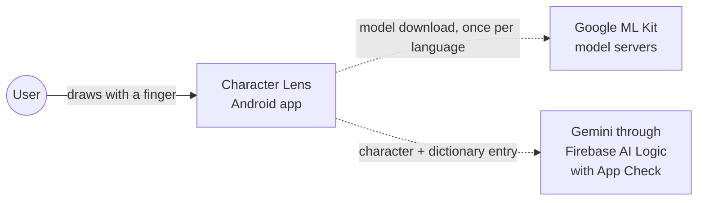
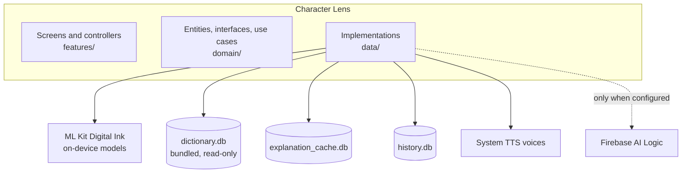
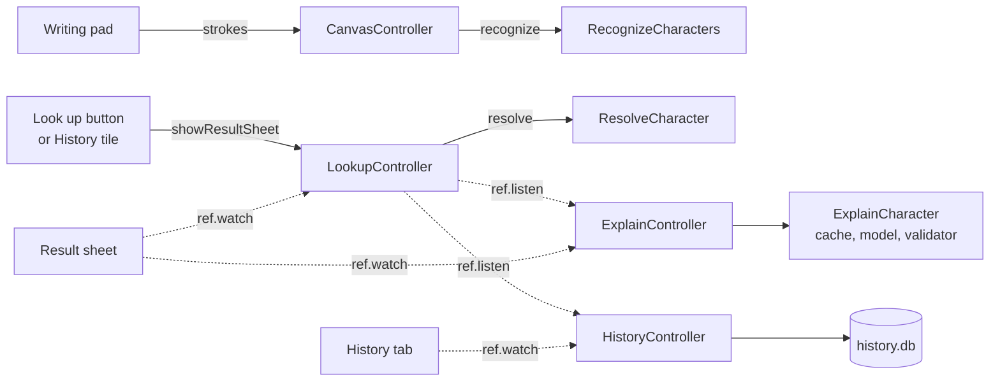

# Architecture

How the app is put together: what runs where, how the code is layered, and which controller listens to which. For the step by step flow of one lookup and its failure paths, see [data-flow.md](data-flow.md). For the AI parts, see [ai-usage.md](ai-usage.md). Decisions and their reasons are in [docs/adr](adr).

## Context



There is no backend of my own. Recognition, the dictionary, the cache and the history run on the device. The two network calls are the one-time model download for each language, and the optional AI explanation. Strokes never leave the device: the request to Gemini is built from a dictionary entry and a language, nothing else.

## What runs on the device



Three SQLite files, each with its own job:

| File | What it holds | Written by |
| --- | --- | --- |
| `dictionary.db` | Readings, definitions and variants of 60,183 characters from Unihan 18.0.0, bundled as an asset and opened read-only | The build script `tool/build_dictionary.dart`, not the app |
| `explanation_cache.db` | One AI explanation per character, language and prompt version | The app, after a successful model call |
| `history.db` | The last 50 lookups: character, language and time | The app, when a lookup loads |

The cache and the history are separate files because the cache repairs itself by deleting its file when it is damaged, and the history must not go with it.

## Layers

```
lib/
  features/   canvas, result, history, home   screens, widgets, Riverpod controllers
  domain/     ink, dictionary, explainer, history, tts   entities, failures, interfaces, use cases
  data/       ink, dictionary, ai, cache, tts   implementations of the interfaces
  core/       theme
```

- **Features** depend on the domain and never name a concrete data class.
- **Domain** is plain Dart with no Flutter imports. A use case exists only where there is a rule to apply: `RecognizeCharacters`, `ResolveCharacter`, `ExplainCharacter` and `ListHistory`.
- **Data** implements the domain interfaces. Each plugin sits behind a small seam, such as `ExplanationModel` for Gemini, so the code around it is tested with a fake.
- **`main.dart`** is the only place that names concrete classes. It overrides the providers, and tests override the same providers with fakes. Without Firebase settings it wires `UnavailableExplainer`.

Folders are grouped by concept (`ink`, `dictionary`, `explainer`, `history`, `tts`) in both `domain/` and `data/`, so the two layers mirror each other.

## Who listens to whom

One state is the hub: the lookup of a character. The AI card and the history react to it and never change it.



Solid arrows are calls. Dotted arrows are Riverpod listening, where the listener only reads.

- **`CanvasController`** owns the strokes, the selected language and the recognition result. `ModelStatusController` listens to its language to check that language's model.
- **`LookupController`** is opened by `showResultSheet`, from the "Look up" button or from a history tile, and closed when the sheet closes. It switches candidate in place.
- **`ExplainController`** listens to the lookup. When an entry is loaded it explains it, and it goes back to idle when the sheet closes or the lookup has nothing to explain. The sheet never calls it.
- **`HistoryController`** listens to the same lookup, records the character and language when it loads, and reloads the list. The History tab only watches it.
- **`SpeechController`** is called by the sheet's speaker button and stopped when the sheet closes.

The lookup, explain, history and speech controllers each keep a request counter that drops an answer that arrives after the user moved on. See [ADR 004](adr/004-riverpod-sealed-states.md).

Why this shape: the sheet has one source of truth for what is open, and a new feature that reacts to a lookup (the AI card, then the history) is added by listening, without touching the lookup code. The cost is that the listeners must exist before the first lookup. `HistoryController` is created when the home screen builds the History tab at app start, and it has no guard for a lookup that was already loaded before it existed. That is a known limit, and it is not a problem today because the tab is built first.

## Package choices

| Package | Used for | Why | Decision |
| --- | --- | --- | --- |
| `flutter_riverpod` | State and dependency injection | Sealed states, providers as seams that tests override | [ADR 004](adr/004-riverpod-sealed-states.md) |
| `equatable` | Value equality of state and entities | Tests compare whole states | [ADR 004](adr/004-riverpod-sealed-states.md) |
| `google_mlkit_digital_ink_recognition` | Handwriting recognition on the device | Strokes stay on the device, and it works offline after the model download | [ADR 001](adr/001-ml-kit-digital-ink.md) |
| `sqflite` | The dictionary, the cache and the history | One storage tool for all three files | [ADR 002](adr/002-unihan-dictionary.md) |
| `flutter_tts` | Pronunciation | Uses the voices installed on the device | README, known limits |
| `firebase_core`, `firebase_ai`, `firebase_app_check` | The AI explanation | No API key in the app, and abuse protection | [ADR 003](adr/003-firebase-ai-logic.md) |
| `http` | A direct dependency, used only for its `ClientException` type in the failure mapper | Maps a network error to "offline" | `firebase_failure_mapper.dart` |
| `sqlite3` (dev) | Building `dictionary.db` from Unihan | Runs in a plain Dart script | [ADR 002](adr/002-unihan-dictionary.md) |
| `mocktail`, `fake_async`, `sqflite_common_ffi` (dev) | Tests | Fakes, timers, and SQLite without a device | README, Tests |

## What is not here

- No backend, no account, no analytics.
- iOS was never built, so nothing in this document is checked on iOS.
- The AI path was exercised on an Android emulator only. See the limits in [ai-usage.md](ai-usage.md).
