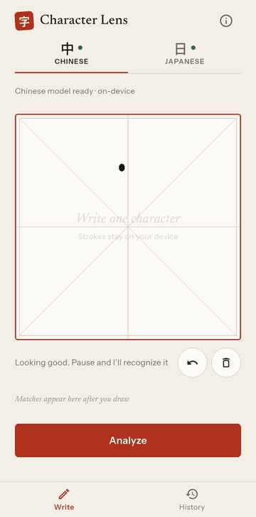

# Case study: Character Lens

Character Lens is an Android app where you draw a Chinese or Japanese character with a finger and look it up. The strokes are recognized on the device, the reading and meaning come from an offline dictionary, and a separate card shows an AI explanation that is labeled and partly checked. I built it as a portfolio piece in Flutter, as a Senior Flutter Engineer, to show on-device ML, offline-first data, and an LLM feature that is not trusted with facts.

This is the story of the decisions, including what went wrong and what I did not measure. Every number below comes from a run described in the linked docs. Everything was run on an Android emulator. I never ran the app on a physical device, and I never built it for iOS.

## In short

- You draw a character, and the strokes are recognized on the device. They never leave it.
- Readings and meanings come only from an offline dictionary built from Unihan. The AI explanation is a separate, labeled card, and the dictionary card never waits for it.
- A validator marks example readings the dictionary cannot confirm. It is loose by design: it flags some correct readings, and it can pass a wrong one.
- No formal evaluation was run. The numbers below are small, from an emulator, and the "under 4 s" AI target is not shown to be met.

## 1. The problem

People see characters on signs, menus and in textbooks, and they cannot type them into a translator because they do not know the phonetic spelling. You cannot search for a sound you cannot say. Drawing the character skips that step: you draw what you see.

## 2. Why handwriting, and why on the device

Strokes are personal input, and recognition has to feel immediate. I set one rule early: strokes never leave the device. That ruled out server-side OCR or a vision model, which would also need a network for every lookup, a per-call cost and a key to manage.

I used Google ML Kit Digital Ink, with one model per language downloaded once. After that, recognition needs no network. The plugin sits behind a small interface, `InkRecognizer`, so the engine can be swapped by changing one override. I did not build or benchmark the alternatives, and [ADR 001](adr/001-ml-kit-digital-ink.md) says so.

What I measured, in two small runs on an emulator with one attempt per character (木 水 日 語 学, in Chinese and Japanese):

- The intended character was at rank 1 in 10 of 10 cells, in both runs. That shows the engine works on these characters. It is not an accuracy rate.
- In the app, recognition took 34 to 144 ms, median about 55 ms. This leaves out the 600 ms pause before recognition starts.

The surprise was the candidate list. ML Kit returned up to 10 candidates, and they include multi-character strings, symbols, digits and simplified forms. The app keeps only candidates that are exactly one character and exist in the dictionary, and then takes the first five. The cap comes after the filter, so noise does not use up the places. The filter cannot remove a real but rare Han character, so a sloppy drawing can still offer one.

## 3. Why the model is grounded and not the source of truth

A language model can write a good memory hook for a character, and it can also state a wrong reading with full confidence. A wrong reading is worse than no reading. So the rule is that readings and definitions shown as fact come only from the dictionary.

The dictionary is the Unicode Han Database (Unihan 18.0.0, dated 2026-07-31), built into a SQLite file by a script in the repo. It has 60,183 characters and adds 3.22 MB to the app. A lookup took 0 to 17 ms in a release build on the emulator, median 2 ms, for five characters. It has gaps that I documented instead of hiding: of 44,355 characters with a Mandarin reading, 22,186 have no definition, and Unihan does not link every pair of simplified, traditional and Japanese forms.

The AI explanation (components, a memory hook, two example words) comes from Gemini through Firebase AI Logic, with App Check, so there is no API key in the app. The design rules are in [ADR 005](adr/005-grounded-llm.md):

1. The dictionary card draws first and never waits for the model. The AI card is a separate card with an "AI-generated" badge.
2. The prompt contains the dictionary entry and tells the model it is the source of truth. Only the character and its entry are sent. The request builder takes an entry and a language and nothing else, so strokes cannot reach it.
3. The output is constrained to a JSON schema, and the parser checks the shape again. An invalid answer is asked for once more, then dropped.
4. A validator checks the reading of each example word against the dictionary and marks any it cannot confirm as "Unverified reading".
5. Answers are cached per character, language and prompt version, so each character costs one call.

The prompt and schema are versioned in the repo (`prompt_v1`), and the version is part of the cache key.

## 4. The hardest trade-off: how loose the validator should be

The validator was the part I thought about most, because it decides what a visitor can trust.

A strict check would need to split an example word into its characters and compare each reading, and Unihan has no word dictionary to do that. So the check is a "contains" test: an example is verified when its reading contains one of the dictionary readings of the character. For Japanese, the kana is first turned into romaji to compare with Unihan's style.

That choice has a cost in both directions, and I wrote both down:

- **It flags correct readings.** 学校 is がっこう, which does not contain GAKU because of a sound change. 物語 is ものがたり, and the reading of 語 changes to がたり. 日本 is にほん, and Unihan has no `NI` for 日. In the spike, 3 of 20 examples were unverified, and all 3 were correct readings caught by these limits. The README screenshot of the flagged 物語 is this case.
- **It can pass a wrong reading.** The test looks only at the part it knows. For 木 (mù), a made-up reading like mùxyz would pass. So "verified" means "the dictionary does not disagree", not "correct". The docs say this in those words.

I chose a flag over removing or correcting an example. A flagged example stays visible with a mark, because most flags are correct readings and hiding them would remove good content. The mark shows the doubt and leaves the decision to the reader. Most limits err on the side of marking a right answer as doubtful, which costs usefulness but does not show a wrong fact as verified. The loose "contains" rule is the one that goes the other way, and that is why the validator is a flag and not proof.

The validator does not cover everything. It checks example readings only. On 2026-11-01, while taking the README screenshots, I read the AI card for 学 in Chinese and found a wrong usage note: it said the traditional form 學 is still used in Japan, but Japan uses 学, and the card shows 学 under JP on the same screen. Nothing flagged it, because usage notes are not checked. I found it by reading, not by a test. The card carries the "AI-generated" badge and a note that memory hooks can be plausible-sounding folk etymology for this reason.

## 5. What was measured, and what was not

No formal evaluation was run. I cut it for scope and effort. What exists is small, and I do not call it an eval.

| What | Result | Where from |
| --- | --- | --- |
| AI call time, spike, debug build | median 3.9 s, 3.1 to 5.3 s, 10 calls | [ADR 003](adr/003-firebase-ai-logic.md) |
| AI call time, spike, release build | median 3.2 s, 3.0 to 8.7 s, 10 calls | [ADR 003](adr/003-firebase-ai-logic.md) |
| AI call time, second run, debug build | median 6.2 s, 3.2 to 24.2 s, 11 calls, poor network at the time, one call past the 15 s timeout | [ADR 003](adr/003-firebase-ai-logic.md) |
| Tokens per call | 386 to 528 in total | [ai-usage.md](ai-usage.md) |
| Validator on the spike | 20 examples, 17 verified, 3 unverified, all 3 correct readings caught by known limits, no wrong reading seen | [ai-usage.md](ai-usage.md) |
| Cards read by hand against the dictionary | 3 (語 in Japanese, 水 in Chinese, 水 in Japanese), none contradicted it, 7 others not read | [ai-usage.md](ai-usage.md) |
| Tests | more than 600, line coverage 95.9% of the files the tests load, measured 2026-10-31 | README, Tests |

The target I set was an AI explanation "under 4 s typical, with a skeleton". The spike medians were under it, the second run's median was not, and latency has a long tail. I do not claim the target was met.

What I did not do:

- No fixed list of characters was chosen in advance, and no pass criteria were written before the runs.
- Only example readings are checked automatically. Meanings, components, memory hooks and usage notes are not, and no answer was compared with an outside reference.
- No second reviewer, and 20 examples cannot show that a wrong reading never gets through.
- No physical device, no iOS build, and App Check with Play Integrity is not confirmed to be accepted (enforcement for Firebase AI Logic starts on 2026-11-02).
- No prompt version was compared with another, because only `prompt_v1` exists.

## 6. What I would change

- **Run a real evaluation.** Choose a list of characters first, write the pass criteria, and have a second person read a sample. That is the missing piece of the case for the validator.
- **Check usage notes and components,** or stop asking for them. The 学 error shows the schema asks for things the app cannot verify.
- **A stricter validator** with word segmentation, if I find a word dictionary with a license that fits. It would cut the false flags.
- **A physical device and iOS.** Latency and recognition numbers from an emulator on a laptop CPU do not tell how it feels on a phone.
- **Close two known gaps:** `HistoryController` has no guard for a lookup that was already loaded before it existed (it works today only because the History tab is built first), and Unihan has no field that says which form is current in Japan, so a drawn 學 shows as 學 in the Japanese row.

## Where to look

- [architecture.md](architecture.md): the layers and which controller listens to which.
- [data-flow.md](data-flow.md): one lookup, step by step, with its failure paths.
- [ai-usage.md](ai-usage.md): what the AI is trusted for, cost, latency and what was checked.
- [ADRs](adr): the decisions and their alternatives.
