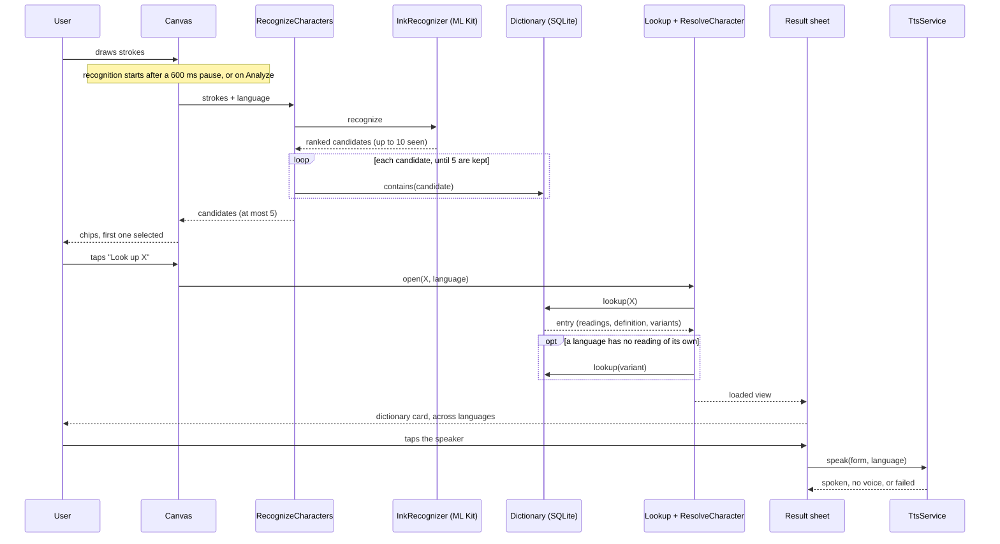
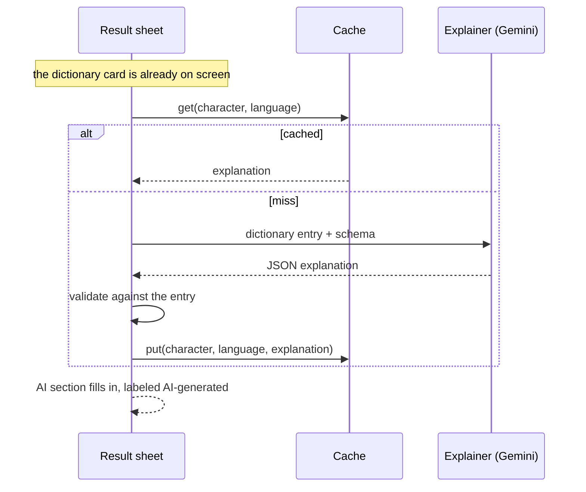

# Data flow

How a drawing becomes a result, which parts exist today, and what happens when a step fails. The AI explanation is planned for M3 and is shown separately, so this page does not describe code that is not there.

## What exists today

Notes on the steps:

- **Strokes** stay on the device. They are mapped to an ML Kit ink object and never sent anywhere. Only the model download uses the network, once per language.
- **Filtering** keeps a candidate only if it is exactly one character and the dictionary has an entry for it. The cap of 5 applies after the filter, so noise does not use up the places. See [ADR 001](adr/001-ml-kit-digital-ink.md).
- **Selecting** a candidate on the canvas does not look anything up. The lookup starts when the user taps "Look up", or switches with "Not it?" inside the sheet.
- **Resolving** follows the one-hop variant rule in [ADR 002](adr/002-unihan-dictionary.md): own readings first, and a borrowed reading only when the drawn character has none for that language.
- **Speaking** uses the written form shown in the header, in the language the user drew in.

## State at each step

Each concern has its own sealed state, so closing the sheet leaves the strokes and candidates as they were. See [ADR 004](adr/004-riverpod-sealed-states.md).

| State | Values |
| --- | --- |
| `CanvasState` | Idle, Recognizing, Result (candidates and selection), Error (a typed failure) |
| `LookupState` | Closed, Loading, Loaded, NotFound, Failed |
| `SpeechState` | Idle, Speaking, NoVoice, Failed |

The lookup and speech controllers count their requests. An answer is used only if no newer request, switch or close happened while it was on its way. When the sheet already shows a result and the user switches candidate, it keeps that result until the new one arrives, so it does not flash a loading skeleton.

## Failure paths

Every failure ends in a readable state, not a crash. Test names are from the test files.

| What fails | What the user sees | Test |
| --- | --- | --- |
| Model not downloaded | "Download the Chinese model first" | `canvas_controls_test`: a missing model reported by the recognizer is readable |
| Nothing recognized | "No match. Try writing it larger" | `canvas_controls_test`: an empty recognition is a readable error |
| Nothing left after the filter | The same message | `canvas_controller_test`: turns a recognition with nothing in the dictionary into a NoCandidates error |
| The recognizer throws | "Recognition failed. Try again" | `canvas_controls_test`: a recognizer error is a readable error |
| Dictionary cannot be opened while recognizing | "The dictionary could not be opened. Try again" | `canvas_controls_test`: a dictionary that cannot be opened is a readable error, and trying again works once the dictionary opens |
| Character not in the dictionary | Sheet: "Not in the dictionary" | `result_sheet_view_test`: says the character is not in the dictionary |
| Dictionary cannot be opened at lookup | Sheet: "The dictionary could not be opened" with "Try again" | `result_sheet_view_test`: says the dictionary could not be read, with a retry; `result_sheet_flow_test`: a dictionary that cannot be read shows a retry that works |
| Dictionary asset missing or corrupt | Either of the two rows above | `sqlite_dictionary_test`: a corrupt bundled file throws DictionaryUnavailableFailure; a missing asset makes contains throw too; a bundled file with the wrong tables throws; an Error from the asset loader is also a failure |
| No text-to-speech voice | "No voice installed for this language" | `speech_controller_test`: no voice is shown as NoVoice; `flutter_tts_service_test`: without a voice it is noVoice and never speaks |
| Speech fails | "Could not play the sound" | `speech_controller_test`: a failure is shown as Failed |
| Answer arrives after the user moved on | Dropped, nothing shown | `lookup_controller_test`: an answer for a character the user left is dropped; an answer that arrives after close is dropped |

The no-voice case was not reproduced on a device. It is covered by tests with a fake service.

## Timing

- **Recognition:** measured on an Android device, 34 to 144 ms for the `recognize` call, median about 55 ms, for ten character and language pairs. That leaves out the 600 ms pause before recognition starts. Details and what was not recorded are in [ADR 001](adr/001-ml-kit-digital-ink.md).
- **Dictionary lookup:** measured once on the Medium_Phone emulator in a release build, ten lookups (five characters in Chinese and Japanese): 0 to 17 ms, median 2 ms, against a target of under 50 ms. This covers the lookup and the resolve step, not drawing, recognition or rendering. The variant-borrowing case and the first database copy were not timed. Details are in [ADR 002](adr/002-unihan-dictionary.md).

## Planned for M3

None of this exists yet. It is the part of the original sequence that comes after the dictionary card.

The dictionary card never waits for this part. Readings and definitions come only from the dictionary, and anything the explainer says that disagrees with the entry is flagged. The failure paths for this part (timeout, invalid JSON) will be added here when it is built.
