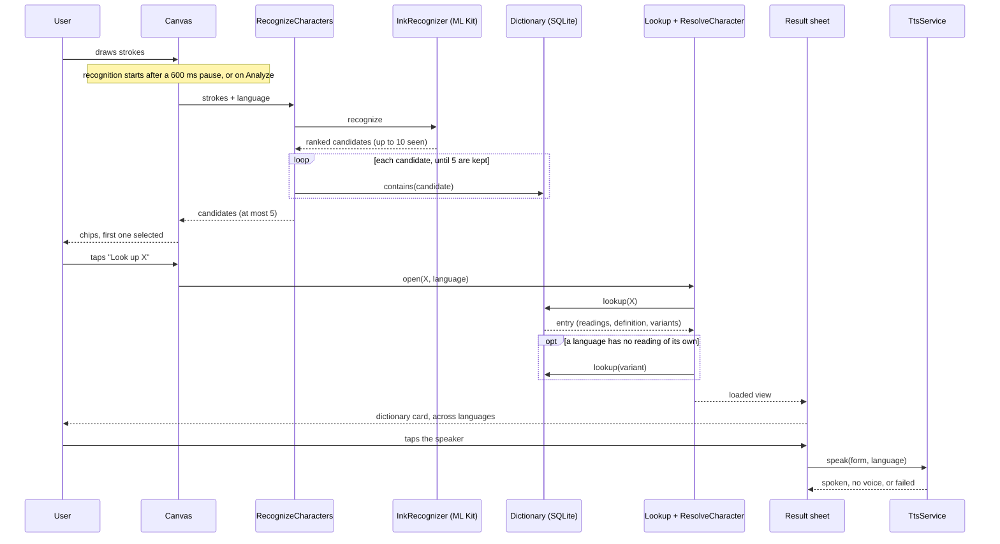
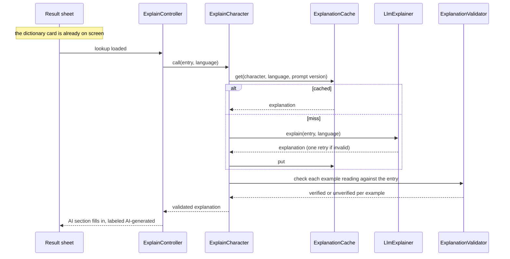

# Data flow

How a drawing becomes a result, which parts exist today, and what happens when a step fails. The AI explanation and the history, added in M3, come after the dictionary card and are described in their own sections.

## From strokes to the dictionary card

Notes on the steps:

- **Strokes** stay on the device. They are mapped to an ML Kit ink object and never sent anywhere. Only the model download uses the network, once per language.
- **Filtering** keeps a candidate only if it is exactly one character and the dictionary has an entry for it. The cap of 5 applies after the filter, so noise does not use up the places. See [ADR 001](adr/001-ml-kit-digital-ink.md).
- **Selecting** a candidate on the canvas does not look anything up. The lookup starts when the user taps "Look up", or switches with "Not it?" inside the sheet.
- **Resolving** follows the one-hop variant rule in [ADR 002](adr/002-unihan-dictionary.md): own readings first, and a borrowed reading only when the drawn character has none for that language.
- **Speaking** uses the written form shown in the header, in the language the user drew in.

## State at each step

Each concern has its own sealed state, so closing the sheet leaves the strokes and candidates as they were. See [ADR 004](adr/004-riverpod-sealed-states.md).

| State | Values |
| --- | --- |
| `CanvasState` | Idle, Recognizing, Result (candidates and selection), Error (a typed failure) |
| `LookupState` | Closed, Loading, Loaded, NotFound, Failed |
| `SpeechState` | Idle, Speaking, NoVoice, Failed |

The lookup and speech controllers count their requests. An answer is used only if no newer request, switch or close happened while it was on its way. When the sheet already shows a result and the user switches candidate, it keeps that result until the new one arrives, so it does not flash a loading skeleton.

## Failure paths

Every failure ends in a readable state, not a crash. Test names are from the test files.

| What fails | What the user sees | Test |
| --- | --- | --- |
| Model not downloaded | "Download the Chinese model first" | `canvas_controls_test`: a missing model reported by the recognizer is readable |
| Nothing recognized | "No match. Try writing it larger" | `canvas_controls_test`: an empty recognition is a readable error |
| Nothing left after the filter | The same message | `canvas_controller_test`: turns a recognition with nothing in the dictionary into a NoCandidates error |
| The recognizer throws | "Recognition failed. Try again" | `canvas_controls_test`: a recognizer error is a readable error |
| Dictionary cannot be opened while recognizing | "The dictionary could not be opened. Try again" | `canvas_controls_test`: a dictionary that cannot be opened is a readable error, and trying again works once the dictionary opens |
| Character not in the dictionary | Sheet: "Not in the dictionary" | `result_sheet_view_test`: says the character is not in the dictionary |
| Dictionary cannot be opened at lookup | Sheet: "The dictionary could not be opened" with "Try again" | `result_sheet_view_test`: says the dictionary could not be read, with a retry; `result_sheet_flow_test`: a dictionary that cannot be read shows a retry that works |
| Dictionary asset missing or corrupt | Either of the two rows above | `sqlite_dictionary_test`: a corrupt bundled file throws DictionaryUnavailableFailure; a missing asset makes contains throw too; a bundled file with the wrong tables throws; an Error from the asset loader is also a failure |
| No text-to-speech voice | "No voice installed for this language" | `speech_controller_test`: no voice is shown as NoVoice; `flutter_tts_service_test`: without a voice it is noVoice and never speaks |
| Speech fails | "Could not play the sound" | `speech_controller_test`: a failure is shown as Failed |
| Answer arrives after the user moved on | Dropped, nothing shown | `lookup_controller_test`: an answer for a character the user left is dropped; an answer that arrives after close is dropped |

The no-voice case was not reproduced on a device. It is covered by tests with a fake service.

## Timing

- **Recognition:** measured on an Android emulator, 34 to 144 ms for the `recognize` call, median about 55 ms, for ten character and language pairs. That leaves out the 600 ms pause before recognition starts. Details and what was not recorded are in [ADR 001](adr/001-ml-kit-digital-ink.md).
- **Dictionary lookup:** measured once on the Medium_Phone emulator in a release build, ten lookups (five characters in Chinese and Japanese): 0 to 17 ms, median 2 ms, against a target of under 50 ms. This covers the lookup and the resolve step, not drawing, recognition or rendering. The variant-borrowing case and the first database copy were not timed. Details are in [ADR 002](adr/002-unihan-dictionary.md).

## The AI explanation

It starts when the lookup is loaded, and the dictionary card never waits for it. `ExplainController` only listens to the lookup state, so the sheet does not call it.

- **Cache first.** The key is character, language and prompt version. A miss calls the model once. A failed call is not stored.
- **Validation runs on every answer,** cached or not, so the marks always come from the current dictionary and validator.
- **The AI card has its own state:** `ExplainState` is Idle, Loading, Ready (the explanation and a check per example) or Unavailable (a typed failure). Switching candidate keeps the old explanation until the new entry arrives.
- **A stale answer is dropped,** with the same request counter as the lookup.

More in [ai-usage.md](ai-usage.md), [ADR 003](adr/003-firebase-ai-logic.md) and [ADR 005](adr/005-grounded-llm.md).

## History

`HistoryController` listens to the lookup state too. When a lookup is loaded it records the character and language, then reloads the list.

- **Stored:** character, language and time, in its own SQLite file (`history.db`), apart from the explanation cache because the cache repairs itself by deleting its file. The last 50 are kept and a repeat moves to the top.
- **Shown:** `ListHistory` joins each entry with the dictionary, so readings and meanings still come from the dictionary and are not stored twice. An entry the dictionary cannot read is listed without them.
- **Reopened:** a tile opens the same result sheet, and the explanation comes from the cache when it is there, so it opens without a network.
- A lookup that found nothing or failed is not recorded.

## AI failure paths

The dictionary card stays in every case. Test names are from the test files. The full list with messages is in [ai-usage.md](ai-usage.md).

| What fails | What the user sees | Test |
| --- | --- | --- |
| No Firebase settings in the build | "AI explanation is not set up in this build." | `explain_controller_test`: not configured is Unavailable |
| No connection | "No connection, so there is no AI explanation. Open it again to retry." | `firebase_failure_mapper_test`: a socket error is offline |
| Model takes more than 15 s | "The AI explanation took too long. Open it again to retry." | `llm_explainer_test`: ends a call that never answers, with no retry |
| Invalid JSON twice | "The AI explanation could not be used." | `llm_explainer_test`: twice is dropped, after exactly one retry |
| App Check, key, quota or blocked answer | "The AI service refused the request." | `firebase_failure_mapper_test`: App Check failing; a quota that is used up |
| Cache cannot be read or written | Treated as a miss, or the answer is kept for this view | `explain_character_test`: a cache that cannot be read is a miss |
| Answer arrives after the user moved on | Dropped, nothing shown | `explain_controller_test`: an answer that arrives after the sheet closed is dropped |
| History cannot be read | "History is not available right now." | `history_controller_test`: a history that cannot be read is Unavailable |

The offline case was seen on the emulator in airplane mode. The timeout, App Check rejection, 1.5x system font and Japanese were not tried on a device.

## AI timing

Measured on an Android emulator, 20 calls of the real prompt (five characters in Chinese and Japanese, debug and release builds): medians 3.9 s and 3.2 s, slowest 8.7 s, and one call in the app took 8 to 10 s. Tokens per call were 386 to 528. A physical device was not measured. The table is in [ADR 003](adr/003-firebase-ai-logic.md).
