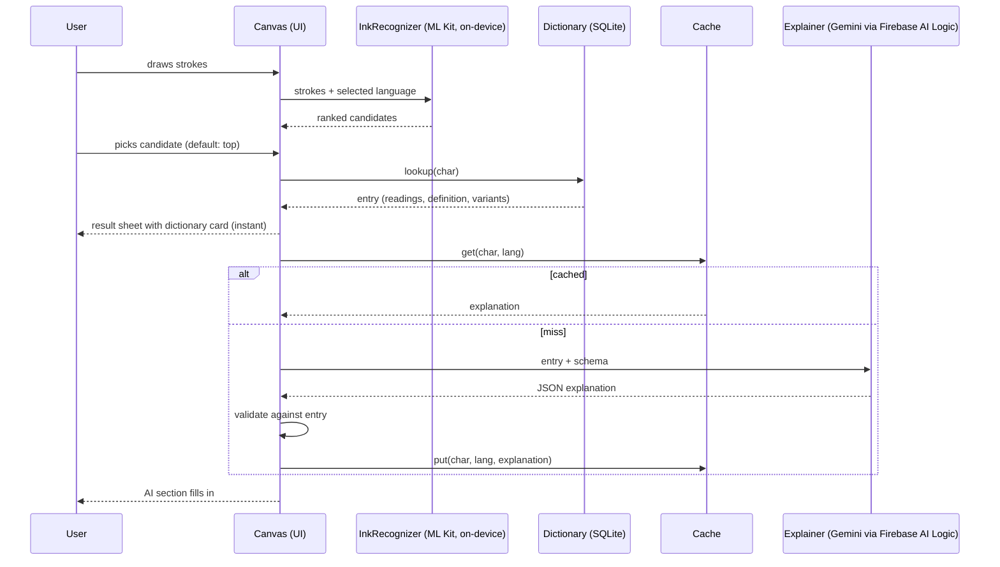

# Product Requirements Document: Character Lens (v2)

Status: revised 2026-10-22. Target: a finished, well-documented app in about 2 to 3 weeks of part-time work.

What changed from v1: scoped to Han characters so cross-language matching is real; recognition candidates added; offline dictionary is the source of truth; the LLM is a grounded "explain" layer, not the data source; API key moved behind Firebase AI Logic; documentation and case-study deliverables are part of the scope.

---

## 1. Overview

**Character Lens** lets a user draw a Chinese, Japanese or Korean-Hanja character with a finger, recognizes it on-device, and shows its pronunciation, meaning, cross-language readings, and an AI-generated explanation (components, mnemonic, example words).

- **Audience:** language learners, travelers, linguistics enthusiasts.
- **Problem:** people see characters on signs, menus and textbooks but cannot type them into a translator because they do not know the phonetic spelling.
- **Solution:** handwrite it, pick the right candidate, get verified dictionary data plus a grounded AI explanation.

### 1.1 Goals

1. Ships as a working Android app with a demo GIF.
2. Demonstrates on-device ML, offline-first data, and a _grounded_ LLM feature with a validator.
3. Comes with real documentation: system design, data flow, AI usage, decisions, and a case study (section 8).

### 1.2 Scope

| In MVP                                   | Phase 2 (not now)                                                     |
| ---------------------------------------- | --------------------------------------------------------------------- |
| Input: Chinese (Hanzi), Japanese (Kanji) | Arabic, Hindi (no shared-root feature, needs a different data source) |
| Output matches: CN, JP, KO (Hanja)       | Korean Hangul input                                                   |
| Single character                         | Multi-character words                                                 |
| History (local)                          | Bookmarks, stroke-order validation, camera OCR                        |

---

## 2. Functional requirements

### 2.1 Language selector

CN / JP segmented control. Shows the on-device model state per language: not downloaded, downloading (progress), ready, failed (retry). Digital Ink models download once per language, so the first use needs a network.

### 2.2 Drawing canvas

`CustomPaint` canvas with a practice-sheet grid, real-time strokes, Undo (last stroke), Clear, and a status line (Ready, Recognizing, Looking up, Error). Strokes are stored as point lists with timestamps, which is what ML Kit needs.

### 2.3 Recognition with candidates

Recognition runs automatically after a short pause (about 600 ms) or on tapping Analyze. ML Kit returns a ranked list; show the top 5 as chips, top result preselected. Tapping a chip loads that character. Input is locked while recognizing.

### 2.4 Result sheet

Modal bottom sheet with:

- Large character, language tag, simplified/traditional variant if different.
- **Dictionary card (verified):** pronunciation per language (Pinyin, Japanese on/kun, Korean Hangul reading) and English definition, from the bundled dictionary.
- **Cross-language matches:** the same character's readings and meaning in CN, JP and KO.
- Audio button (TTS) with a graceful fallback when no voice is installed.
- **AI explanation (clearly labeled "AI-generated"):** see 2.5.

### 2.5 AI explanation (the LLM feature)

For the selected character, the LLM returns structured JSON:

- `components`: the parts of the character and what each contributes (e.g. radical plus phonetic component).
- `mnemonic`: one or two sentences to remember it.
- `examples`: 2 common words using it, each with reading and meaning.
- `usage_note`: optional, a difference in usage between CN and JP.

Rules (these make it a _grounded_ feature, and they are the case-study story):

1. The prompt includes the dictionary entry as context. The model may not change readings or definitions; those fields are rendered from the dictionary only.
2. Output is constrained by a JSON schema; invalid output is retried once, then dropped (the sheet still shows the dictionary card).
3. A lightweight validator checks that any reading in `examples` matches the dictionary or is flagged as unverified.
4. Results are cached locally per character and language, so each character costs one call, ever.
5. If offline or the call fails, the AI section shows a quiet "unavailable" state. Nothing else breaks.

### 2.6 History

Last 50 recognized characters, stored locally, tap to reopen (uses the cache, works offline).

---

## 3. Non-functional requirements

- Recognition under 500 ms after the model is ready (on-device).
- Dictionary lookup under 50 ms (local SQLite).
- AI explanation under 4 s typical, shown with a skeleton; the dictionary card must render first, never wait for the LLM.
- Works fully offline except first model download and uncached AI explanations.
- No secrets in the app bundle or repo.
- Accessibility: tap targets 48 dp, text scales, TTS and sheet content readable by screen readers.

---

## 4. Architecture

Feature-first with three layers. Riverpod for state.

```
lib/
  features/
    canvas/        presentation: canvas, toolbar, candidate chips
    result/        presentation: result sheet, AI section
    history/
  domain/          entities (Stroke, Candidate, CharacterEntry, Explanation), repository interfaces, use cases
  data/
    ink/           MlKitInkRecognizer (implements InkRecognizer)
    dictionary/    SqliteDictionary (bundled Unihan-derived DB, read-only)
    ai/            GeminiExplainer (implements Explainer), prompt builder, schema, validator
    cache/         ExplanationCache + HistoryStore (sqflite)
    tts/           TtsService
```

Key decisions (each becomes a short ADR in `docs/adr/`):

| Decision        | Choice                                                                                                        | Why                                                            |
| --------------- | ------------------------------------------------------------------------------------------------------------- | -------------------------------------------------------------- |
| Recognition     | Google ML Kit Digital Ink, on-device                                                                          | Private, fast, no per-call cost                                |
| Source of truth | Bundled dictionary built from Unicode **Unihan** (kMandarin, kJapaneseOn/Kun, kKorean, kDefinition, variants) | One dataset covers all three languages, offline, deterministic |
| LLM             | Gemini through **Firebase AI Logic** (`firebase_ai`) with App Check                                           | No API key in the app; no custom backend to run                |
| LLM role        | Explainer only, grounded on dictionary, JSON schema output                                                    | Avoids hallucinated readings in a learning tool                |
| State           | Riverpod with sealed state classes (Idle, Recognizing, LookingUp, Result, Error)                              | Predictable flow, easy to test                                 |
| Storage         | sqflite: read-only dictionary asset, separate cache/history DB                                                | Simple, fast, no codegen                                       |
| Interfaces      | `InkRecognizer`, `Dictionary`, `Explainer` abstractions                                                       | Swap/mocking in tests, shows clean boundaries                  |

Licensing note: Unihan is under the Unicode license; keep attribution in the About screen and README.

---

## 5. Data flow



Failure paths to document and test: model not downloaded, empty recognition, character not in dictionary, LLM timeout/invalid JSON, no TTS voice.

---

## 6. AI usage (documented in `docs/ai-usage.md`)

- **Two AI components:** on-device handwriting recognition (ML Kit) and a cloud LLM for explanations. Explain why each runs where it does (privacy and latency vs. generative ability).
- **Grounding:** dictionary entry in the prompt, schema-constrained output, validator, UI separation of verified vs. AI content.
- **Prompt and schema** kept in the repo, versioned (`prompt_v1`), with the reasoning for each constraint.
- **Evaluation:** no formal eval was run. Decision 2026-10-31: the eval script was dropped for scope and effort. The docs report what was measured instead (the spike, an emulator pass, the validator tests) and say it is not an evaluation.
- **Cost and latency:** measure average tokens and response time, show the effect of caching.
- **Limits:** the mnemonic and component explanations are plausible-sounding folk etymology at times; the UI says so, and the doc says so.

---

## 7. Security and privacy

- No API key in the app or repo. Firebase AI Logic keeps the key server-side; enable App Check to limit abuse; set a usage quota.
- Strokes never leave the device. Only the recognized character and the dictionary entry go to the LLM.
- No account, no analytics in MVP.

---

## 8. Documentation and case-study deliverables

Built progressively, not at the end. Each milestone below lists the doc it produces.

```
docs/
  architecture.md     context + container diagram, layers, package choices
  data-flow.md        the sequence diagram above, plus failure paths
  ai-usage.md         grounding design, prompt, schema, what was checked, cost/latency, limits
  adr/                001 ml-kit, 002 unihan, 003 firebase-ai-logic, 004 riverpod, 005 grounded-llm
  case-study.md       problem, constraints, decisions, what went wrong, results, what I'd do next
README.md             pitch, demo GIF, feature list, architecture thumbnail, run instructions, license
```

**README must have:** one-line pitch, demo GIF, "How it works" with the diagram, tech stack, how to run (including Firebase setup without committing secrets), link to the case study.

**Case-study outline:** (1) the problem and who has it, (2) why handwriting and why on-device, (3) why the LLM is grounded and not the source of truth, (4) the hardest bug or trade-off (likely candidate ranking, Han variants, or LLM output validation), (5) what was measured and what was not, with the small numbers there are (no eval was run), (6) what I would change.

**Repo hygiene for GitHub:** repo description and topics (flutter, riverpod, mlkit, gemini, clean-architecture), CI running `flutter analyze` and tests, screenshots in `docs/images/`, MIT license plus Unihan attribution.

---

## 9. Milestones

| #   | Deliverable                                                                                      | Doc produced                               |
| --- | ------------------------------------------------------------------------------------------------ | ------------------------------------------ |
| M1  | Canvas, strokes, ML Kit recognition with candidate chips, model download state                   | ADR 001, 004                               |
| M2  | Unihan-derived SQLite builder script, dictionary lookup, result sheet, TTS                       | ADR 002, `data-flow.md`                    |
| M3  | Firebase AI Logic explainer, schema, validator, cache, history                                   | ADR 003, 005, `ai-usage.md`                |
| M4  | Tests (stroke mapper, dictionary, validator, state), polish, demo GIF (no eval) | `case-study.md`, README, `architecture.md` |

Cut order if time runs short: history, then the CN/JP usage note, then undo. Never cut the validator.

---

## 10. Acceptance criteria

- Draw 木, 水, 日, 語, 学 in both CN and JP and get the intended character in the top 5 candidates.
- Dictionary card appears without waiting for the LLM, and works in airplane mode after models are downloaded.
- AI example readings the dictionary does not confirm are marked unverified (validator tests, and checks on the emulator).
- Every failure path in section 5 shows a non-crashing, understandable state.
- `docs/` and README complete; demo GIF in the README; CI green.

---

## 11. Open questions (resolved)

- Shinjitai: resolved in [ADR 002](adr/002-unihan-dictionary.md) (one-hop variant rule).
- Fit of `firebase_ai` with the Flutter and Firebase versions: resolved in [ADR 003](adr/003-firebase-ai-logic.md).
